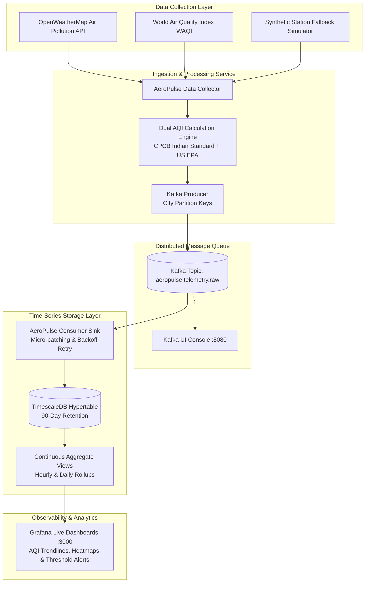

# 🌫️ AeroPulse: Distributed Real-Time Air Quality Telemetry & Stream Processing Engine

[](https://python.org)
[](https://kafka.apache.org)
[](https://www.timescale.com/)
[](https://www.docker.com/)
[](https://grafana.com)

> **AeroPulse** is an enterprise-grade distributed streaming platform designed to ingest, validate, and process real-time air quality telemetry across global and high-density Indian metropolitan zones (Delhi, Mumbai, Pune, Bengaluru, London, Tokyo, New York). The platform streams telemetry via **Apache Kafka**, persists time-series data into **TimescaleDB hypertables**, and serves live analytical visual dashboards in **Grafana**.

---

## 🏛️ System Architecture



---

## 🌟 Key Engineering Highlights

1. **Dual AQI Indexing Standard**:
   - Computes traditional **US-EPA AQI** (1 to 5 index).
   - Implements full mathematical interpolation for **Indian CPCB (Central Pollution Control Board)** AQI across 6 sub-indices: $PM_{2.5}, PM_{10}, NO_2, SO_2, CO, O_3$.
2. **Partitioned Apache Kafka Ingestion**:
   - Partitions telemetry streams by `city` key to guarantee FIFO event sequencing per station.
   - Fault-tolerant producer with callback error backoffs.
3. **TimescaleDB Time-Series Optimization**:
   - Uses **Hypertables** with automated chunk intervals for high-velocity write throughput.
   - Materialized **Continuous Aggregates** compute 1-hour and 1-day rollups on the fly.
   - Built-in data retention policy automatically prunes data older than 90 days.
4. **Resilient Consumer Sink**:
   - Micro-batch ingestion (20 records or 8-second timeout buffer).
   - Exponential reconnect backoff circuit breaker for database resilience.

---

## 📊 Monitored Monitoring Stations

| City | Country | Lat / Lon | Primary Concern |
|------|---------|-----------|-----------------|
| **Delhi** | India | 28.6139° N, 77.2090° E | High winter PM2.5 / Smog inversion |
| **Mumbai** | India | 19.0760° N, 72.8777° E | Coastal humidity + particulate accumulation |
| **Pune** | India | 18.5204° N, 73.8567° E | Urban sprawl & transport emissions |
| **Bengaluru** | India | 12.9716° N, 77.5946° E | Tech corridor traffic particulates |
| **London** | UK | 51.5074° N, 0.1278° W | NO2 diesel vehicle compliance |
| **Tokyo** | Japan | 35.6762° N, 139.6503° E | Baseline metropolitan air quality |
| **New York** | USA | 40.7128° N, 74.0060° W | EPA ozone & particulate monitoring |

---

## 🚀 Getting Started

### 1. Prerequisites
- [Docker Desktop](https://www.docker.com/products/docker-desktop) installed and running.
- (Optional) Python 3.10+ if running standalone outside Docker.

### 2. Setup Environment
```bash
git clone https://github.com/FARINATTAR/AeroPulse-Distributed-Air-Quality-Telemetry-Stream-Processing-Engine.git
cd AeroPulse-Distributed-Air-Quality-Telemetry-Stream-Processing-Engine

# Copy environment variables
cp .env.example .env
```

### 3. Launch Cluster via Docker Compose
```bash
docker compose up -d
```

### 4. Verify Access Endpoints
- **Grafana Dashboards**: [http://localhost:3000](http://localhost:3000) (`admin` / `admin`)
- **Kafka UI Console**: [http://localhost:8080](http://localhost:8080)
- **TimescaleDB Engine**: `localhost:5432` (`aeropulse_admin` / `aeropulse_secure_2026`)

---

## 📂 Project Structure

```
AeroPulse/
├── docker-compose.yml           # Full stack (Kafka, Zookeeper, TimescaleDB, Grafana, App)
├── Dockerfile                   # Container definition for AeroPulse pipeline
├── Makefile                     # Developer CLI automation commands
├── requirements.txt             # Core Python package dependencies
├── sql/
│   └── init.sql                 # TimescaleDB hypertables, indexes, & rollups
├── grafana/
│   └── provisioning/
│       └── datasources/         # Auto-provisioned TimescaleDB connection
├── src/
│   ├── config.py                # Pydantic configuration & city coordinates
│   ├── data_collector.py        # Ingestion engine + CPCB AQI calculator
│   ├── kafka_producer.py        # Partitioned Kafka telemetry producer
│   ├── kafka_consumer.py        # Micro-batch sink into TimescaleDB
│   └── main.py                  # Multi-threaded orchestrator & signal handler
└── README.md                    # Engineering documentation
```

---

## 📜 License
MIT License. Developed by [Farin Attar](https://github.com/FARINATTAR).
